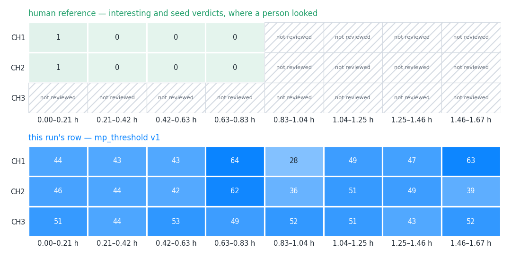
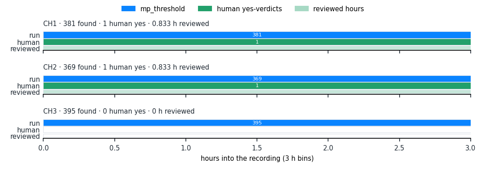
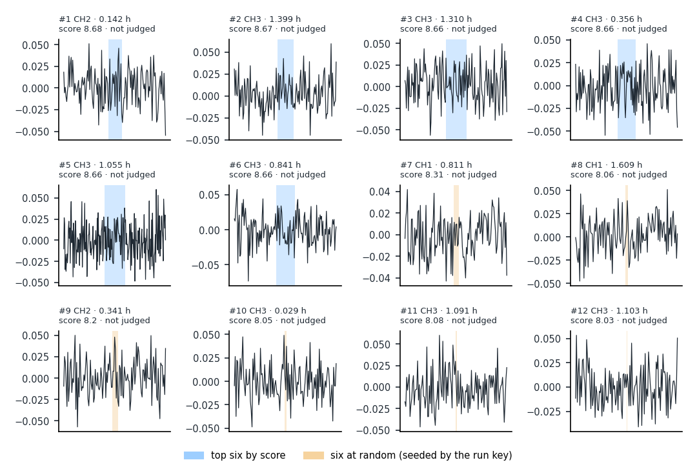
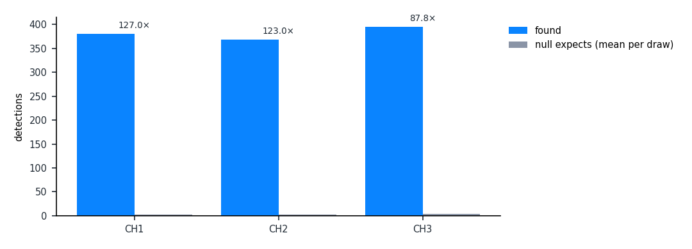

# Detection run report — mp_threshold

_syn.mat · CH1, CH2, CH3 · section 0.00–1.67 h · rendered 2026-10-18T23:23:32+00:00_

What a detection algorithm found in this recording, side by side with what a person marked by hand. Think of a spell-checker run over a book a proof-reader has partly read: the map shows which pages each of them covered, the scoreboard counts where they agree on the pages both read, the strip shows where in the book the checker flagged most, and twelve example flags let you judge them by eye. The null comparison says how many flags the checker would raise on scrambled text of the same kind (chance level); the last section records everything needed to run it again.

## 1. Detection map

*Discovery › Map, syn.mat, 8 equal time slices.*

**human reference — interesting and seed verdicts, where a person looked**

| channel | 0.00–0.21 h | 0.21–0.42 h | 0.42–0.63 h | 0.63–0.83 h | 0.83–1.04 h | 1.04–1.25 h | 1.25–1.46 h | 1.46–1.67 h |
|---|---|---|---|---|---|---|---|---|
| CH1 | 1 in 0.208 h | 0 in 0.208 h | 0 in 0.208 h | 0 in 0.208 h | not reviewed | not reviewed | not reviewed | not reviewed |
| CH2 | 1 in 0.208 h | 0 in 0.208 h | 0 in 0.208 h | 0 in 0.208 h | not reviewed | not reviewed | not reviewed | not reviewed |
| CH3 | not reviewed | not reviewed | not reviewed | not reviewed | not reviewed | not reviewed | not reviewed | not reviewed |

**this run's row — mp_threshold v1**

| channel | 0.00–0.21 h | 0.21–0.42 h | 0.42–0.63 h | 0.63–0.83 h | 0.83–1.04 h | 1.04–1.25 h | 1.25–1.46 h | 1.46–1.67 h |
|---|---|---|---|---|---|---|---|---|
| CH1 | 44 in 0.208 h | 43 in 0.208 h | 43 in 0.208 h | 64 in 0.208 h | 28 in 0.208 h | 49 in 0.208 h | 47 in 0.208 h | 63 in 0.208 h |
| CH2 | 46 in 0.208 h | 44 in 0.208 h | 42 in 0.208 h | 62 in 0.208 h | 36 in 0.208 h | 51 in 0.208 h | 49 in 0.208 h | 39 in 0.208 h |
| CH3 | 51 in 0.208 h | 44 in 0.208 h | 53 in 0.208 h | 49 in 0.208 h | 52 in 0.208 h | 51 in 0.208 h | 43 in 0.208 h | 52 in 0.208 h |

1. A covered cell gives the count of detections (human row: interesting and seed verdicts) and the hours covered in that slice. 'not run' means no run of this algorithm reached the slice; 'not reviewed' means nobody looked there — not the same as looking and finding nothing.
2. The run's row is the Map page's row for this algorithm: coverage is the union of every live run of the same steps, each slice counted from the newest run that covers it.

## 2. Scoreboard against the human reference

| channel | found | already judged | reviewed | interesting | precision | recall · reviewed overlap | null expects / draws | × null |
|---|---|---|---|---|---|---|---|---|
| **total** | 1145 | 0 | 0 | 0 | containment — nothing judged · extent 0 % (0/11) | 0.00 over 1.667 h | 10.5 / 2 draws | 109.0× |
| CH1 | 381 | 0 | 0 | 0 | containment — nothing judged · extent 0 % (0/6) | 0.00 over 0.833 h | 3 / 2 draws | 127.0× |
| CH2 | 369 | 0 | 0 | 0 | containment — nothing judged · extent 0 % (0/5) | 0.00 over 0.833 h | 3 / 2 draws | 123.0× |
| CH3 | 395 | 0 | 0 | 0 | not yet scored | no reviewed overlap | 4.5 / 2 draws | 87.8× |

1. **found** — detections this run made on the channel, inside the section.
2. **already judged** — detections that already carried a human verdict before the run started.
3. **reviewed** — detections a human verdict covers, by the rule below.
4. **interesting** — the reviewed detections whose covering verdict is a yes (interesting or seed).
5. **precision** — containment: interesting ÷ reviewed, with yes/judged beside it; extent: the share whose extent agrees with an event-shaped human row under the matching rule. Precision alone rewards timidity.
6. **recall · reviewed overlap** — the share of the human yes-verdicts the run found, over the channel's reviewed hours; the total row states the hours it pooled.
7. **null expects / draws** — the mean count the paired surrogate (null) runs found on the same scope, over the number of draws per channel.
8. **× null** — found ÷ null expects. A null that found nothing leaves it empty: there is no ratio to take.
9. **Reviewed** means: a human verdict covers the detection: a verdict given on it in Review, or reviewed windows that wholly contain it and agree (Q-D2 (a), Q41's rule).
10. **Matching rule** (a detection and a human span are the same event): criterion reciprocal_iou_onset, iou 0.5, onset 0.25.
11. The total pools 1.667 reviewed hours.

## 3. Where the run fires

*Detections per 3 h bin per channel (blue), the human yes-verdicts in the same bins (green), over the reviewed hours (pale underlay).*

## 4. Twelve example detections

*The six best by score (highest score) and six at random, seeded by the run key so a re-render shows the same six. The band is the detection's span; the verdict is a human one, if it has one.*

| # | pick | channel | at (h) | duration (s) | score | verdict | detection id |
|---|---|---|---|---|---|---|---|
| 1 | top | CH2 | 0.1417 | 18 | 8.683 | not judged | 420 |
| 2 | top | CH3 | 1.3992 | 22 | 8.672 | not judged | 1089 |
| 3 | top | CH3 | 1.3103 | 30 | 8.664 | not judged | 1073 |
| 4 | top | CH3 | 0.3556 | 26 | 8.664 | not judged | 849 |
| 5 | top | CH3 | 1.0547 | 44 | 8.662 | not judged | 1017 |
| 6 | top | CH3 | 0.8414 | 27 | 8.661 | not judged | 962 |
| 7 | random | CH1 | 0.8108 | 7 | 8.306 | not judged | 188 |
| 8 | random | CH1 | 1.6094 | 3 | 8.057 | not judged | 374 |
| 9 | random | CH2 | 0.3406 | 7 | 8.2 | not judged | 462 |
| 10 | random | CH3 | 0.0294 | 2 | 8.046 | not judged | 774 |
| 11 | random | CH3 | 1.0908 | 2 | 8.08 | not judged | 1024 |
| 12 | random | CH3 | 1.1031 | 1 | 8.032 | not judged | 1028 |

## 5. Null comparison

*Per channel, what the run found beside what its null expects by chance.*

| channel | found | null expects / draws | × null |
|---|---|---|---|
| CH1 | 381 | 3 / 2 draws | 127.0× |
| CH2 | 369 | 3 / 2 draws | 123.0× |
| CH3 | 395 | 4.5 / 2 draws | 87.8× |

1. Null: paired surrogate runs drawn with the run; method phase_randomize; 2 draws per channel.

## 6. Parameters and provenance

|  |  |
|---|---|
| recording | syn.mat (syn.mat) |
| channels | CH1, CH2, CH3 |
| section | 0.0000–1.6667 h |
| Discovery session | test |
| run | mp_threshold — mp_threshold (done, 1145 found) |
| template | mp_threshold v1 |
| null | {"drawn": 2, "draws": 2, "paired": true, "params": {"method": "phase_randomize", "seed": 0}} |
| database | C:\Users\mmebr\AppData\Local\Temp\claude\C--Users-mmebr-Documents-CNN\3e66d3d6-b22e-4b0c-a877-b178d922f81f\scratchpad\bridge1\reports\db\annotations.sqlite (read from the sandbox copy C:\Users\mmebr\AppData\Local\Temp\claude\C--Users-mmebr-Documents-CNN\3e66d3d6-b22e-4b0c-a877-b178d922f81f\scratchpad\bridge1\reports\runtime\20261019-reports\annotations.sqlite) |
| code commit | 75f2e764483a794ec5270ab74c6a97d9779788c5 |
| rendered | 2026-10-18T23:23:32+00:00 |
| account | mmebr |

| # | block | parameters |
|---|---|---|
| 1 | preprocessing.detrend | {"mode": "rolling_mean", "window_s": 600.0} |
| 2 | detection.matrix_profile | {"backend": "stump", "window_min": 1.0} |
| 3 | detection.threshold | {"threshold": 8.0} |

1. Every step parameter is the run's own recipe, as executed.
