# Round B on the website: B5, B6, B9, B10 and B12 (3 Nov 2026)

These are the five round-B questions run on the freeze day. Each section opens in plain words, then gives the numbers,
then the screenshots of the website's own pages that show the result. Each also points to its findings file, which
holds the full method and caveats.

- **Data:** the swept UQ recordings, with species as set today:
  - M2_aug: oyster;
  - CO: chocolate oyster;
  - M2_concat, LM and L_LM/MJu26a: lion's mane.
- **Exclusions:** *S. commune* appears in nothing here, because its blind exam (queue 37) is still open. M4 is held out.

## B5: when and where do the detectors fire? (Discovery › Map)

**In plain words.** The Map shows how often each detector fires on each channel, and its channel view shows that in
3-hour steps across the whole recording.

- **Detectors agree on *when*.** On every one of 45 channels, busy and quiet periods line up across settings.
- **A scrambled copy hardly does that.** A copy of the signal with the same frequency content but scrambled timing
  barely shows it. So the busy and quiet periods are real changes in the recordings over hours and days.
- **What causes them is open.** Without the environment logs we can't say whether it is the fungus or the room.

| recording | detectors rise and fall together (0 = no, 1 = always) | same, time-shifted | scrambled copy | channels band together |
|---|---|---|---|---|
| M2_aug (oyster) | 0.35 | 0.00 | 0.02 | yes (0.29) |
| M2_concat (lion's mane) | 0.33 | 0.00 | 0.05 | yes, but so does its copy: CH5–8 are copies |
| CO (chocolate oyster) | 0.26 | 0.00 | 0.02 | yes (0.20) |
| LM (lion's mane) | 0.30 | 0.00 | 0.02 | no (0.00) |
| L_LM (lion's mane) | 0.21 | 0.00 | 0.04 | yes (0.23) |

**The website:**

*One channel over 30 days (M2_aug CH6, 3 h bins). Most detectors are busy in days 0–8 and 15–17, together:*
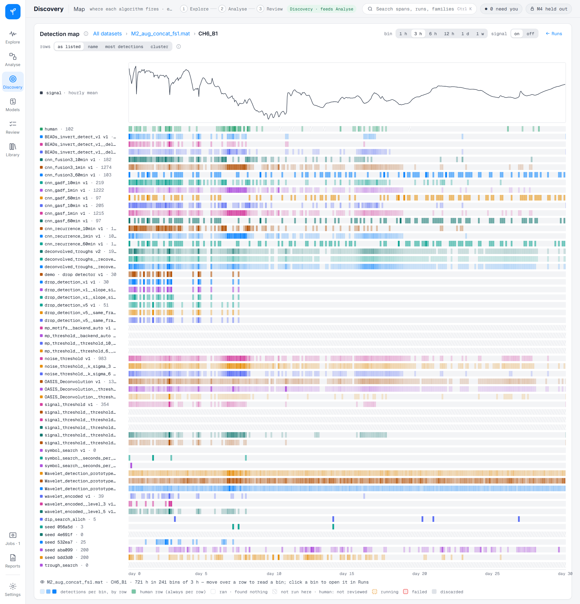

*The whole Map (where each setting fires):*
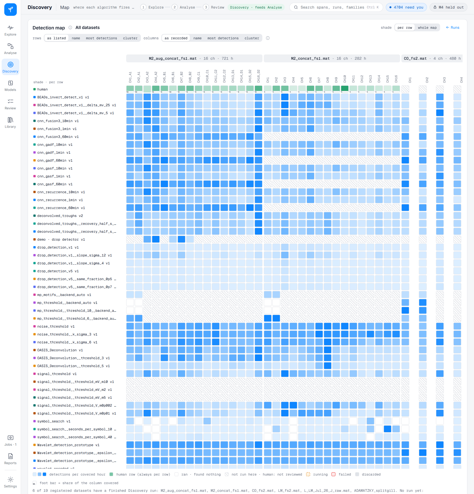

*M2_aug in eight time chunks per channel. Within a channel, the busy chunks line up down the rows:*
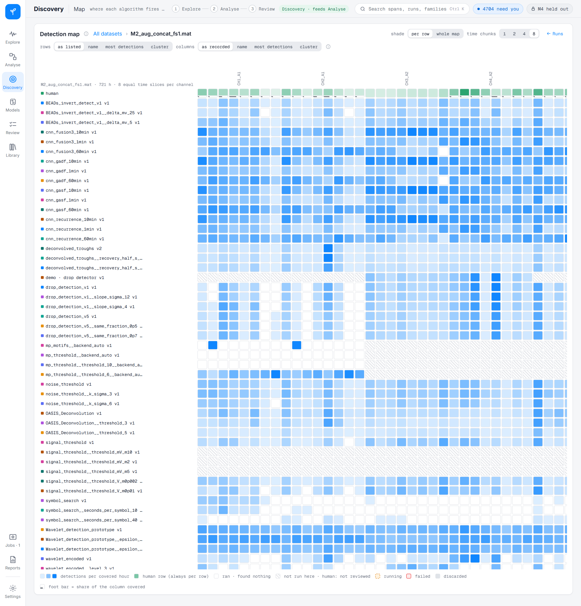

**Also:** `b5_map_channel_M2_concat_CH5.png` and `b5_map_channel_CO_CH1.png`.

**Findings:** `docs/rq_roundA_2/findings/b5-map-timing-2026-11-03.md`.

## B6: do the same shape families occur across recordings and species? (Library › Recurrence, Atlas)

**In plain words.** The Library sorts events into 42 shape families.

- **Shapes are shared.** Almost every family turns up on more than one recording (39 of 42) and more than one species
  (39 of 42).
- **The mix is not random.** Which recording an event came from predicts its family about twice as well as chance:
  each recording leans towards some families. Only three families sit on one recording, all M2_aug.
- **Species can't be separated from recording.** We have one oyster and one chocolate-oyster recording.

| measure | real | if recordings were random | p |
|---|---|---|---|
| families on 2 or more recordings | 39 / 42 | 41.3 | 0.023 |
| families on 2 or more species | 39 / 42 | 41.3 | 0.024 |
| how much origin predicts family (bits, recording) | 0.22 | 0.13 | 0.0001 |
| same, species | 0.17 | 0.08 | 0.0001 |

**The website:**

*Library › Recurrence, g-11, member counts per channel (M2_aug, M2_concat, CO):*
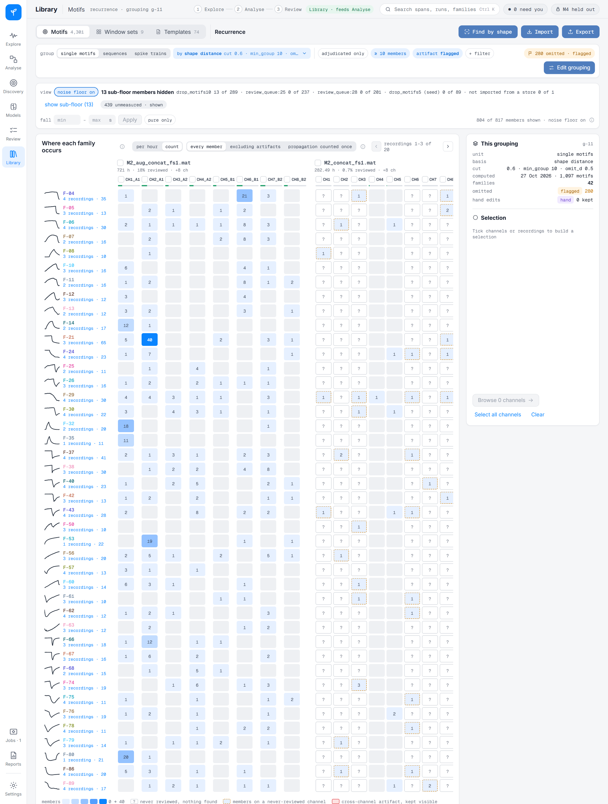

*The next recordings, with LM's channels:*
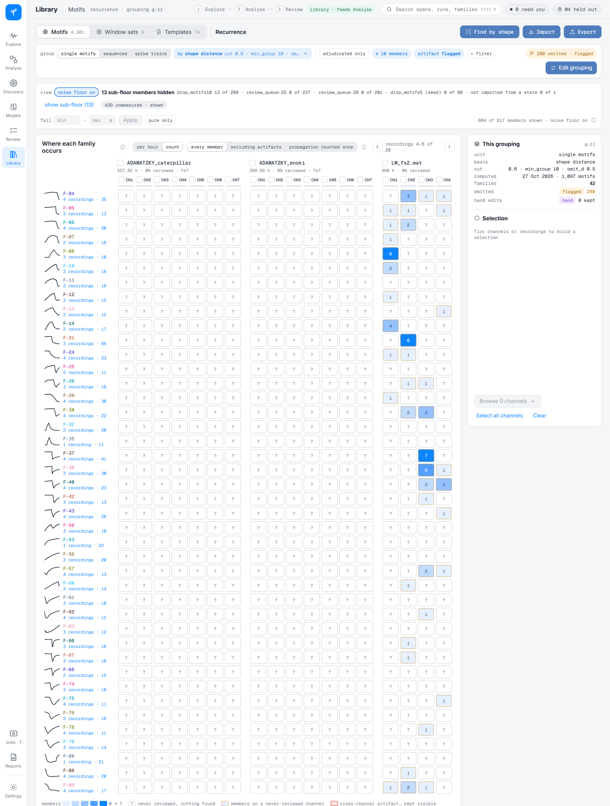

*Library › Atlas, g-11 (the family shapes):*
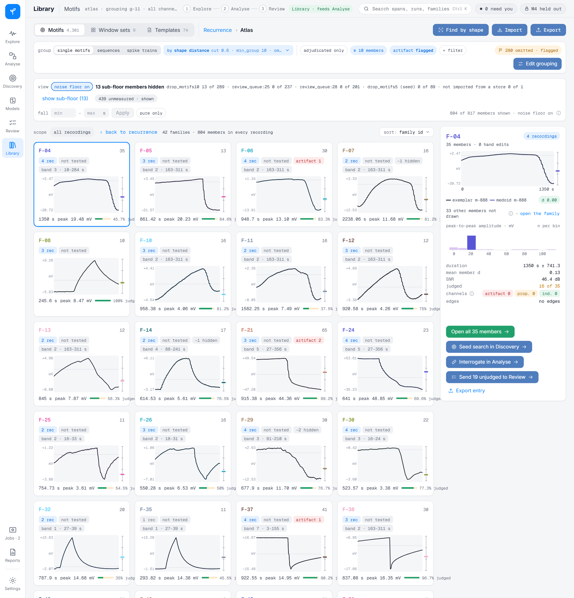

**Findings:** `docs/rq_roundA_2/findings/b6-families-species-2026-11-03.md`.

## B12: do shapes and intervals differ between recordings and species?

**In plain words.** We compared the 716 events you accepted in the blind queues, recording by recording.

- **Shapes differ a little between recordings.** The difference is real but small, and it holds after allowing for
  event length.
- **A species difference is not shown.** The three lion's mane recordings differ from each other at least as much as
  oyster differs from lion's mane.
- **The rhythm of events doesn't differ by species.** The difference between datasets is borderline and fails
  correction.

**The website could not answer this one.** Its Interrogation pages read only the 16 seed families, and the
"Review selection" and "Prior run" sources are not wired. So every test ran in the backend on the same functions the
pages call. The screenshots show what the site offers today.

| question | result |
|---|---|
| do recordings differ in shape? | yes, small: 11 of 15 measures pass correction (7 of 10 after removing duration); largest effect ε² 0.06 |
| do species differ in shape? | not shown: R² 0.005 (p 0.06), against 0.035 among the lion's mane recordings |
| do intervals differ (LV, CV2)? | borderline by dataset (p 0.06–0.07, fails correction), no by species (p 0.38) |
| share of accepted events that are falls (fastest edge) | 91 % (76–98 % per recording) |

**The website**, Analyse › Aggregate on the id024 sharkfin family (M2_aug):

**Backend figure:**
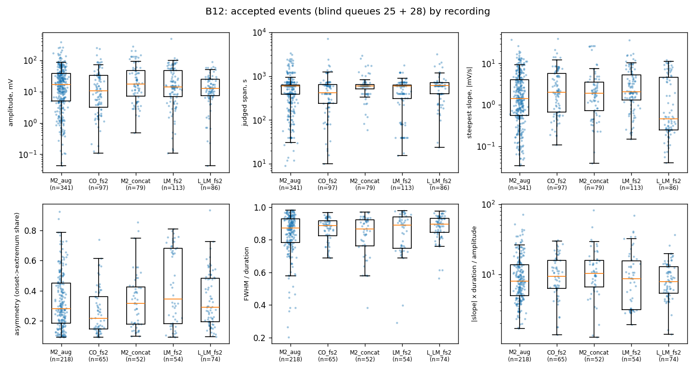

**Findings:** `docs/rq_roundA_2/findings/b12-shapes-intervals-2026-11-03.md`.

## B9: do event durations cluster at preferred scales? (Analyse, `cwt_events`)

**In plain words.** Adamatzky suggests fungal spikes come in a few preferred lengths. We ran the CWT drop detector on
20 one-day spans and compared it with copies of the same spans that keep every value but shuffle the timing (AAFT).

- **The detector doesn't beat its scrambled copies.** The copies gave *more* drops (1,087) than the real recordings
  (632), with the same spread of lengths.
- **The "preferred lengths" are the detector's.** Real durations do show two humps (about 17 s and 87 s), but the
  scrambled copies show them too, and more strongly.
- **The earlier check was too easy.** This detector had "passed" against a gentler null, phase scrambling, which
  reshapes the values and gives almost no drops. Against the stricter null it finds nothing beyond noise.

| measure | real | AAFT copies | phase copies |
|---|---|---|---|
| drops on 20 one-day spans | 632 (260 clean) | 1,087 (517 clean) | 5 |
| spans where real beats its copy | 6 of 20 | | |
| durations, real vs AAFT (KS) | p 0.39–0.83 per recording, pooled 0.59 (M2_concat longer, p 0.007) | | |

**The website**, Analyse on M2_aug 348.5–372.5 h: the real span finds 93 drops, its AAFT copy 51, its phase copy 0.

*Real:*
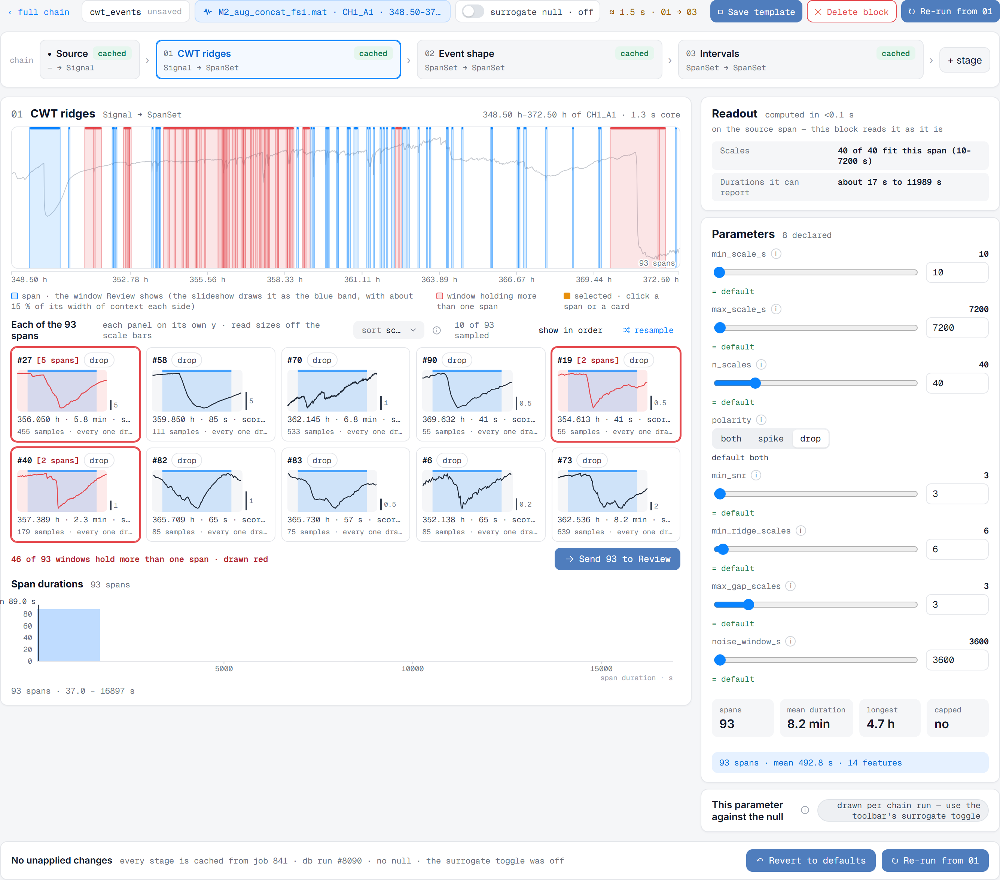

*AAFT copy:*
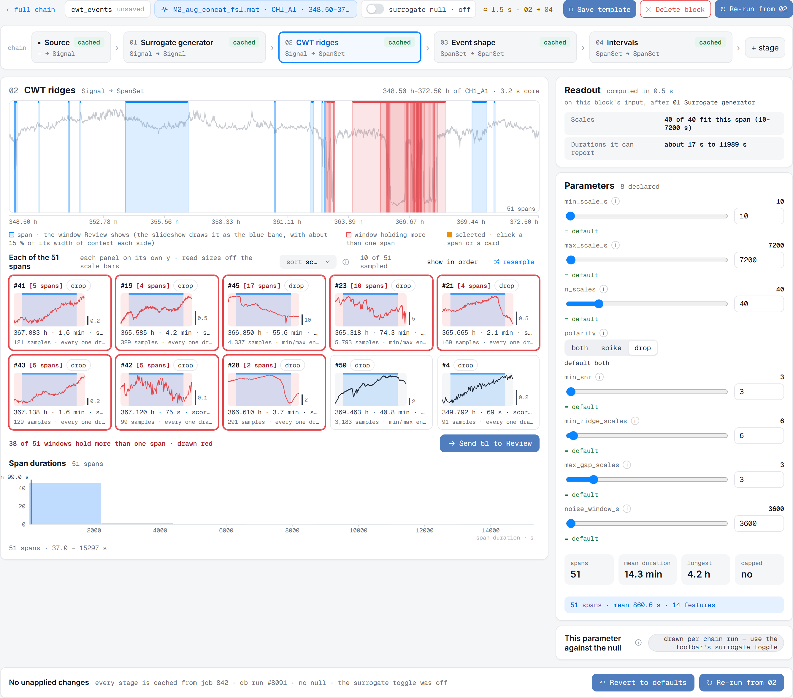

*Phase copy:*
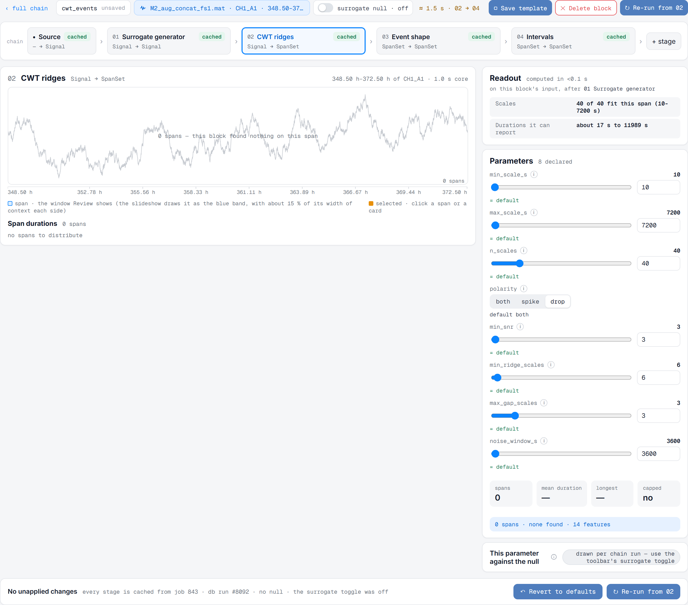

**Backend figure (durations, real against AAFT):**
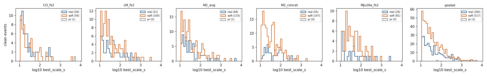

**Findings:** `docs/rq_roundA_2/findings/b9-cwt-durations-2026-11-03.md`.

## B10: at which time scales does structure beyond noise appear? (Analyse, `motif_lengths`)

**In plain words.** We asked at which window lengths, from 30 s to an hour, the recordings repeat themselves more than
noise with the same values and rhythm would.

- **Four recordings: every judged length from 30 s up to several minutes.** On M2_aug, M2_concat, CO and LM, every
  length tested from 30 s up repeats beyond noise, up to between 4 and 25 minutes. There is no single preferred length:
  it is one unbroken band, strongest at the shortest windows.
- **MJu26a: nothing beyond noise.** The span is a steady ~20-minute oscillation that the scrambled copies keep, so
  nothing stands out.

| recording | lengths that repeat beyond AAFT noise | strongest |
|---|---|---|
| M2_aug (oyster) | 30 s – 16.3 min | 30 s |
| M2_concat (lion's mane) | 30 s – 4.4 min | 30 s |
| CO (chocolate oyster) | 30 s – 25.1 min | 30 s |
| LM (lion's mane) | 30 s – 16.3 min | 46.5 s |
| MJu26a (lion's mane) | none | — |

**CNN templates, against one phase-scrambled copy:**
- the 10-minute ones find structure on all five recordings;
- the 60-minute ones on three;
- the 1-minute ones on none.

**The website**, the `motif_lengths` readout on each recording:

*M2_aug:*
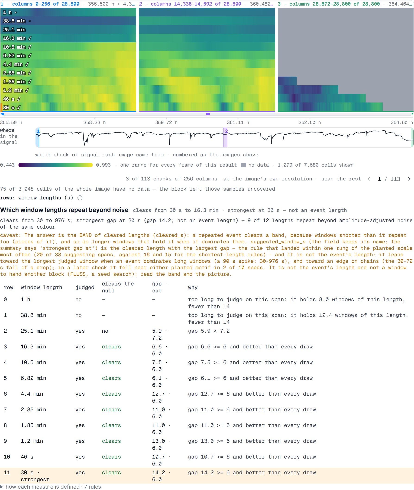

*CO:*
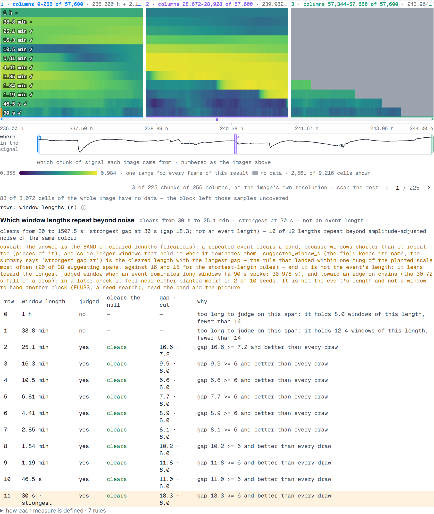

*MJu26a, where nothing clears:*
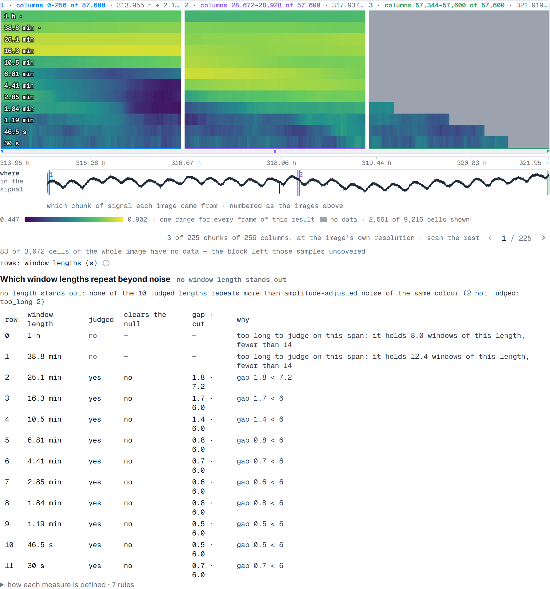

**Also:** `b10_motif_lengths_m2concat.png` and `b10_motif_lengths_lm.png`.

**Findings:** `docs/rq_roundA_2/findings/b10-scales-2026-11-03.md`.

## Where this leaves round B

- **Answered:** B1–B6, B9, B10 and B12.
- **Still open:**
  - B7 (multiscale entropy) waits on the ghost fungus being registered;
  - B8 (motif prevalence) needs long seed searches on the cluster;
  - B11 waits on the 2 Hz sweep.
- **In the thesis:** Chapter 10 carries every answered study with one figure each, and the ledger rows are J7–J11.
